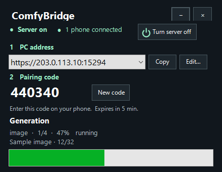

# ComfyBridge

**[Open the beta 58 release page](https://github.com/gkoogz/ComfyBridge/releases/tag/v0.1.0-beta.58)** · [Download the Android APK](https://github.com/gkoogz/ComfyBridge/releases/download/v0.1.0-beta.58/ComfyBridge-0.1.0-beta.58.apk) · [Download Windows](https://github.com/gkoogz/ComfyBridge/releases/download/v0.1.0-beta.58/ComfyBridge-Windows-0.1.0-beta.58.zip) · [All releases](https://github.com/gkoogz/ComfyBridge/releases)


An Android remote for an existing Windows ComfyUI installation. The phone edits generation settings, uploads images and masks, and views results; the PC does the GPU work. A small Windows tray application wakes its Python worker on demand.

**Checkpoint Browser and LoRA listings** show installed files as rich cards: proper source title, version, author, file size, base model, published activation keywords, expandable descriptions and up to three cached non-explicit sample images. Select a checkpoint with its checkbox. Add LoRAs from the browser; active entries are marked and cannot be added twice. See Listing beside an active LoRA opens its own card. Video models also expose See Listing.

The Windows worker indexes local file SHA-256 hashes and queries Civitai's public version API. A verified tensor hash can identify a metadata-only variant; selected known Hugging Face files have exact publisher SHA identities. Unmatched files and local merges remain usable and clearly labelled. Model metadata and previews stay under `%LOCALAPPDATA%/ComfyBridge/model-library`, outside the public repository and releases. Inventory is checked when the worker starts and every 30 minutes while it remains active; unchanged files are not rehashed and source metadata is normally refreshed weekly. Temporary lookup failures retain previously verified cached listings. New models hosted outside the supported source lookups may remain unconfirmed.

Beta 57 makes the Windows X button and Alt+F4 hide to the tray. To exit, right-click the tray icon and choose **Close ComfyBridge**.

Beta 56 reconciles uncertain submissions before restoring settings, expires Quick edits after two hours, resumes the saved queue when Windows ComfyBridge reopens, and makes room for five queue entries in the PC studio. Quick edit uses the same single-response prompt-block path as Notepad chat.

**Notepad chat** talks to a local model on the PC. **Chat about this** under any positive or negative prompt copies it into the Notepad composer without sending it. Drag its handle between tucked-away, composer-only, half-screen and nearly full-screen positions. Send with the up arrow (or Ctrl+Enter on PC). Newest messages appear nearest the composer; replies stream into grey bubbles with a copy button. The restart button asks before clearing the current conversation. It does not change the notes or stickies.

Short conversations and the empty tray surface can also be dragged. Longer conversations scroll with momentum; pulling beyond an edge gently moves the tray with resistance and springs back to a resting position. Text entry, long-press selection and response-copy controls stay separate from the drag gesture.

The active conversation and shared draft are stored on the PC; each app also keeps an offline copy and protects unsent edits when devices disagree. A reply can finish after the app closes. Only the active conversation is retained when starting a new chat. **Add sticky** stays above the chat tray.

Run **Setup-Chat.ps1** in the Windows package once to install the pinned llama.cpp Vulkan runtime and Qwen3.5-9B Q5_K_M weights (about 7.1 GB download) under `E:\ComfyBridge-LLM`. The installer resumes completed byte ranges and verifies SHA-256 before activating the model. It does not install a separate GUI or change ComfyUI's Python environment. Choose an installed GGUF in the compact PC panel or the desktop Bridge column; the phone has no model selector. Additional compatible GGUF files can be placed in the same `models` folder.

Chat starts its model process only for a message and releases it after the reply. Sending a message during a supported H3/Eros Euler video requests a checkpoint at the next sampling boundary. The bridge holds the remaining queue, saves the unfinished packed audio/video latent, cooperatively unloads Comfy models and execution caches, verifies VRAM release, and lets chat use the GPU. After the chat process exits, video reloads its unchanged workflow and continues at the saved step. Images, unsupported samplers and videos started before this update finish before handing off. A large video step can take minutes: pausing is not instant and does not recover an already-stuck step. New generations can join the held queue without interrupting chat. A loopback-only server with an ephemeral access key serves inference; phone requests use the existing encrypted, authenticated bridge. Prompts and replies are not sent to a cloud model. The latest conversation turns are used within the model's context budget; older turns remain visible in the active chat.

**0.1.0-beta.58 is a personal-workflow beta**, adapted specifically to `Image gen.json` and `Video gen.json` in `E:\ComfyUI-Zluda\user\default\workflows`. It is not a general ComfyUI workflow importer. Models, LoRAs, workflow files, prompts, generated media, pairing credentials, and signing keys are not included in this repository or release. Beta 37 requires the updated Windows companion for local chat. Existing generation queues survive the tray update.

The phone shows **PC connected** as soon as the bridge answers. Loading models and unavailable telemetry have their own messages. If the server or VPN drops, leave the phone app open: it retries automatically using the saved pairing. **Disconnect** or **Cancel reconnect** stops those retries.

After a Windows update, the previous worker can finish its jobs and continue serving the library and model list. The tray replaces it when the bridge queue and transfers have drained. Other ComfyUI renders can stay active throughout; you do not have to disconnect your phones or pair them again.

Generator progress bars show an approximate time remaining for the current job. The elapsed-time line also shows the total queue ETA. Estimates use completed jobs on this PC and live sampler timing, and show “estimating” when timing is unavailable. Bridge offers Skip, Stop batch and Stop all. Stop all cancels current ComfyBridge batches from both paired phones.

Prompt fields start reduced when entering a generator, grow as text is typed or pasted, and have a caret below them to show all text or collapse. The manual resize handle remains available.

## Desktop studio

The compact header has extra vertical space and borderless window controls. Click **↖** at the top left of the Windows tray panel to expand it into the desktop studio. The left column keeps server power, phone connection count, address and pairing code, machine telemetry, progress and the shared queue visible. The sidebar opens Image, Video, Library and Notepad. Desktop connects locally without pairing or routing through the VPN, and uses the same saved settings, presets and notes as your phones.

**↘** returns to the compact tray panel; **–** hides it; **×** quits the bridge. Collapse or hide disposes the WebView2 browser; the compact tray remains lightweight and queued generations continue. The expanded window can be moved by dragging its title bar. Microsoft Edge WebView2 Runtime is required (normally included with Windows/Edge).

In the desktop Library viewer, **Open file location** selects the original in Windows Explorer. **Save a copy** opens a Windows save dialog. Videos play directly from the PC file with byte-range seeking. Desktop queue controls can manage batches submitted by either phone; phone cancellation ownership rules remain unchanged.

## Generation details and origins

Open a Library or Archive item: media actions are one horizontally scrolling row, with **Generation details & origins** visible beneath it. Scroll down for its prompts, mode, timestamps, elapsed time, model, seed, LoRAs, dimensions, sampler/VAE components when recorded, and video FPS/frame counts/duration. Each earlier generation shows the same details. Branches are collapsed lists; follow a branch to its result or continue scrolling toward the earliest recorded prompt.

**Send to i2i**, **Make video**, **Extend video**, and **Regenerate** record their source relationships in new jobs. An original input or mask can be inspected full size and saved. Library-sourced inputs also link back to their Library item. Reusing an original imported input records another branch from that input. Actions load the editor without automatically generating.

Details already opened are cached for offline reading. Original inputs need the PC connection on Android. Older generations show only recorded relationships: an unknown parent or missing input is not guessed. Update both Windows and Android for this feature; installing Windows preserves the worker and current queue.

## What is included

Open any image or video in Library or Archive and tap **↗ Regenerate**. The editor loads that individual result's seed, prompts, settings, source and mask. Press Generate when ready. The Windows bridge keeps job settings and new jobs' ComfyUI graphs in its Library database. It stores one copy of each distinct source in `input/ComfyBridge/recipes`, including clips used for extensions. Keep this folder and the Library database together when backing up the PC.

- Bridge home screen with connection animation, CPU/GPU telemetry, RAM, dedicated VRAM, and system commit.
- Image generation: text-to-image, image-to-image, and finger-painted inpainting masks; model and LoRA controls; prompts, seeds, batches of 2/4/8/16, progress, previews, and recent results.
- MiniMax H3 video from a text prompt or starting image, with editable canvas dimensions for text, proportional scaling for images, and frame and FPS controls.
- Separate image/video settings presets, prompt library, and persistent phone state.
- A ComfyBridge generation library with image/video viewing, verified offline playback and camera-roll export, archive, and unarchive.
- Silent Windows sign-in startup, tray monitoring/pairing, authenticated HTTPS with certificate pinning, durable job queue, and worker sleep after inactivity.
- Matching Android launcher, Windows executable/taskbar, and notification-area icons.

Android and the Windows tray check this public GitHub repository in the background on launch. If a newer release includes a matching APK or Windows ZIP, choose **Download** to open the package in your browser or **Later** to keep working. On Android, open the downloaded APK to install it. On Windows, extract the ZIP and run **Install.ps1**.

Tap a panel heading on Image or Video to fold it. The phone remembers each screen’s layout. PC Queue and LoRAs start folded. On Image, the chain between Width and Height locks their current ratio. On Video, the scale track gives most of its travel to rounded resolutions within the 768 × 1152 pixel budget. **Original · 0%** returns to source scale on the model’s 32-pixel grid.

LoRA sliders snap to tenths. Type a value such as **0.12** in the number field for finer control. Generator sliders request a light tick when the phone’s touch feedback is enabled. Image uses **1–50 steps** and Video uses **1–20 steps**, including when opening an older draft or preset.

## Queue, progress, and two phones

Both paired phones can watch the PC queue. **Generate / Add to queue** captures the current settings and adds a new batch even while another is rendering. **Stop mine** targets your first active or queued batch on that screen. Use **Cancel batch** on a specific queue entry instead to keep the others. The PC checks the submitting installation before accepting cancellation. Jobs continue after either phone disconnects.

The percentage is an estimate for the current image or video, alongside its position in the shared PC queue. Adding another generation changes 1/1 to 1/2. The next job shows 2/2, and the counter starts over once the queue empties. It follows the submitted nodes: loading and LoRAs, prompt/source/mask encoding, sampling, VAE decoding, then saving. Video also includes frame assembly and MP4 encoding. Cached nodes have little weight. Between reported steps the estimate advances conservatively, and the PC learns relative stage costs from successful runs. Only indexing a finished result sets a job to 100%.

**Bridge → Backups & notifications → PC settings backup** saves this phone’s settings, prompt library, presets, and starting images/masks to the PC. Check for **Saved on PC** before uninstalling. A fresh installation pairs again and restores the most recently updated profile; **Restore from a phone…** lets you pick another by model, ID and date. Each installation has its own backup. The image editor, video editor and prompt library also sync across paired phones. The latest edit in each section wins. The app checks when an editor opens and every ten minutes while connected and open. Private offline media is repopulated from the PC; a camera-roll export is separate.

**Generation notifications** opens Android notification settings or requests permission. With notifications enabled, your phone watches batches it submits, including when you leave the app. The progress notification displays batch progress and the current item/stage. Completion, cancellation and failure are reported per batch. If the PC becomes unreachable, updates wait for connectivity; Android can defer background updates under its power and foreground-service limits. The other phone's jobs remain visible in the shared queue without sending duplicate alerts to both devices.

PC Queue on either generator shows active jobs and the past 24 hours of results. It scrolls after five entries. On Bridge, the progress bar sits below the existing panes and the expanded queue fills the remaining height. Swipe vertically inside the queue to scroll it, or swipe right from a row to open the sidebar. **Skip** advances past the current image or video. **Stop batch** stops that batch. Both controls are available to the submitting phone. Each generation has its own timer. Finished rows show **Success**, **Aborted** or **Fail** and the final elapsed time. A thumbnail opens the result in Library. Tap **↗** to load that job’s settings, actual seed, starting image and mask into the editor. Tap Generate when ready. The built-in MiniMax turbo LoRA uses the strength from the saved workflow.

Older jobs may have no recorded start. A ≥ time counts from when the upgrade first observed a running job. An ≈ time comes from a unique match between a ComfyUI log entry and an output file. The app shows **Time unavailable** when it cannot recover a duration.

## Notepad

Open **Notepad** from the sidebar to write wrapped text anywhere on the page. An empty pad has 80 writable lines. Once you type, it keeps 30 blank lines beneath your text. **Add sticky** colors the cursor’s row or the rows in a selection. Enter inside a sticky expands it. Backspace at the start of the following row removes its color and keeps the text. Five colors cycle and stay with the note when it syncs. Notes save on the phone as you type and sync through the paired PC. If two phones edit offline at the same time, both drafts are kept in the shared text.

## Gallery and inline playback

Tap a Library tile to open its original at the largest size that fits without cropping. Videos play and seek in the same view. Tap the media to hide or show the bottom **Save to camera roll** and **Archive / Unarchive** controls. Swipe right to bring the grid back under your finger; at a main screen the same gesture opens the menu. Swipe left to tuck the menu away. Generator **Latest result** spans the screen and plays videos in place. Tap a recent thumbnail to change the result shown there. During image generation, tap the spinning first thumbnail to watch the sampler preview at full width. The last preview stays visible until the downloaded original is ready to display. **Skip image** stops that image and continues the queue. The phone that submitted it controls Skip.

In **Video > Canvas & model**, tap **MiniMax H3** or **10Eros Max · Beta 7**. Both use the H3 VAE and Qwen text encoder from the saved workflow. The original restores its four-step Turbo LoRA. Eros selects eight steps, Euler/simple, video/audio shift 12/3 and the VSA attention patch with 10% keep. Other LoRAs and the current prompt/input are preserved. The Windows installer adds an Eros-specific ComfyUI node. It keeps short sequences dense, uses tiled PyTorch VSA on ZLUDA, and delegates to ComfyUI’s native VSA on CUDA GPUs. On ZLUDA, Eros keeps INT8 weights in storage and uses ComfyUI’s per-layer floating-point math for INT8 projections. The Eros patch is scoped to that model.

The optional **Negative prompt** panel sits below the positive prompt. Enter a short description of what to avoid to use experimental negative guidance at CFG 2.0. This adds a model evaluation per sampling step. A blank field uses the original sampling path. With a starting image or an extension, both prompts use the same visual reference.

The supported Eros checkpoint is TenStrip's original beta 7 eight-step Turbo INT8 HQ safetensors (SHA-256 `8a51ca3f7d290a799d89fefcde4ede60962256955a91dfe4746d3cc07814fd6e`). Place it in `models/diffusion_models` to enable the choice. This is distinct from the later BF16 fix1. [Author's checkpoint](https://huggingface.co/TenStrip/10Eros-Max/blob/8afd8538d26f0e44d981920fef82e9c0086c8b71/10Eros_Max_h3_8stepTURBO_beta7_int8HQ.safetensors)

On Video, leave **Starting image** empty for text-to-video. Drag **Resolution** under Width and Height to scale both sides, or enter dimensions and lock the aspect ratio. The slider turns red above the 768 x 1152 pixel budget. Video dimensions snap to multiples of 32. Upload a starting image for image-to-video, or clear it to return to your text-to-video canvas.

Choose **Video length** or **Time to add** from 1–20 seconds. Changing FPS keeps the requested time and updates the editable frame count. A selected video opens Extend mode. Phone clips are uploaded to the PC (up to 512 MiB), oriented for playback, and padded to the MiniMax canvas grid. The PC needs FFmpeg on PATH or installed with Shotcut to import clips. **Include sound** (under the duration in **Canvas & model**) defaults on. H3 generates a soundtrack for new clips and continuations; playback FPS changes preserve pitch. An extension keeps the source audio and adds generated sound after the cut. Turning sound off omits the entire audio track from the new MP4, leaving the original untouched. Sound requires FFmpeg and `minimax_h3_audio_vae_fp32.safetensors` in `models/vae`.

**Extend video** in Latest result, Library, or Archive opens the Video editor with the source resolution and FPS locked. Enter the number of new frames and describe what happens next. The PC uses the last five source frames as a motion guide, trims the overlap, and publishes a new joined clip. The original stays in the library. The original must still be available on the PC.

The app starts fetching missing originals among the **newest 20 generated images and videos combined**, including archived items, as soon as it connects. This works from Bridge, Notepad, or any other screen, before visiting Library. New results are detected during foreground connection checks and join the front of the download list. Already-local originals are skipped. Only one automatic file downloads at a time; an item you open uses a separate transfer lane, and opening the same item shares its existing transfer. Automatic downloads stop when the app leaves the foreground and resume when it returns.

**Library → Phone copies** shows how many of those newest items are ready. Open an older item while connected to fetch it on demand. Android plays videos from a complete private file after its size and SHA-256 match the PC; you can then play it or view an image offline, even after relaunching the app. A failed transfer or low storage leaves existing copies intact. Automatic downloads reserve at least 128 MiB of free space when starting each file.

The phone checks the PC on connection, about every five minutes while open, and when you tap **Check now**. **Library → Phone copies** lists files that changed or disappeared, plus older copies that have left the recent 100. They stay available until you decide. Tap one, choose **Save to camera roll** to export the existing bytes to **DCIM/ComfyBridge**, and optionally confirm replacement or removal. Keeping the private copy requires no action; protected or on-demand copies can temporarily take the total above 100. Archiving only changes where an item is displayed.

## Install the beta

1. Download the APK and Windows ZIP from the beta release. Extract the ZIP to a local folder.
2. Confirm `config.json` points to your ComfyUI installation. This adapter requires the exact saved workflow node layouts, their models/custom nodes, and `venv\Scripts\python.exe` with `aiohttp` and Pillow available. Windows 10/11 with .NET Framework 4.8 is required; Android 8 or later is required.
3. Run `Install.ps1` in PowerShell. It copies the bridge into `%LOCALAPPDATA%\ComfyBridge\app`, registers startup for the current user, and starts the tray icon. For LAN/VPN access, run `AllowNetwork.ps1` once in an administrator PowerShell window. It allows TCP 18764 for this executable only.
4. Install the APK on the phone. Android may require allowing installation from the app used to open it.
5. **On the PC:** click the ComfyBridge cube by the clock (look under the hidden-icons arrow), or open **Start → ComfyBridge**. The panel must say **Server on**. Leave it open.
6. **On the phone:** open **Bridge**, enter the **PC address** exactly as displayed, then enter the **six-digit pairing code** and tap **Pair & connect**. The code works once and expires in five minutes. Click **New code** if needed. After pairing, just tap **Connect to bridge** on future visits.
7. **Away from home:** the PC panel's local address works on its local network. Use **Set remote address…** once to save the HTTPS address *and external port* from your forwarding rule. That address is then the first choice in the panel. Each installation keeps its own addresses private.



A single click opens the compact, rounded panel at the taskbar. **–** hides it; **×** quits the tray and releases its ports. Queued jobs continue in the worker. **Turn server off** closes incoming connections and preserves the off state across restart. Accepted jobs can finish on the PC. The panel shows the connected phone count and generation progress, including the current batch item. **Quit bridge** is in the right-click menu.

Use the same Windows account for installation and daily use. Installing over an existing version preserves its configuration, credentials, library, and Android state. Close active phone requests before upgrading. A worker already running finishes with its loaded version; it adopts updated Python code after sleeping and waking again. Keep the Android signing key backed up privately if building your own upgrades.

## Windscribe access away from home

Windscribe on both devices does not by itself put them on a shared private network. This beta was tested with both ephemeral forwarding and a **permanent static-IP port forward**. The static rule forwards an assigned public TCP port to the PC bridge on TCP 18764. The phone uses `https://STATIC_IP:ASSIGNED_PORT` and the one-time code displayed by the PC. Select the Windows device in the forwarding rule and connect the PC to that exact static-IP location. The phone can use its own VPN location.

Normal gaming and other traffic continue using your existing Windscribe configuration; ComfyBridge does not install another VPN or change your default route. No domain is required for this pinned-certificate connection.

**Ephemeral forwarding expires after seven days**, and a VPN reconnect/location change may change the address. Renew the rule and update the phone address as needed. For this pairing flow, use a Windscribe static IP with permanent TCP forwarding for a stable unattended address. A static IP is purchased separately from Windscribe. The owner's installation now uses its configured static IP; account credentials and endpoint configuration are not bundled in the beta. See [Windscribe port forwarding](https://windscribe.com/knowledge-base/articles/do-you-support-port-forwarding/) and [static IP options](https://windscribe.com/staticips/).

The PC must be awake, its user signed in, Windscribe connected to the appropriate server, and the tray application running. This release does not wake a sleeping or powered-off PC.

## Workflows and settings

The bridge reads the saved workflow JSON on worker startup. It obtains available checkpoints and LoRAs from the existing ComfyUI API; no model copies are created. Original workflow files remain unchanged.

Image defaults follow the saved sampler and LoRAs, with 1024 × 1536 as the initial app resolution. Without an input image, denoise is locked to 1. Image upload selects i2i; a painted mask selects inpainting. White mask pixels are the region to regenerate. Presets include the input image and mask and are stored on the phone.

The saved video scheduler has an invalid numeric scheduler and a one-step setting. This adapter substitutes `simple`, four steps, and denoise 1 for the saved turbo LoRA. The video model and first LoRA identity are fixed. H3 frame counts round up to `17k + 5`; duration is **actual frames / FPS**. Resolution rounds to a 32-pixel grid, so source aspect ratio is approximate. Red indicators mark over 768 × 1152 pixels or over 300 requested frames; these are warnings, not hard limits.

Batch seeds increment when the batch is accepted; disabling increment repeats the chosen seed. Cancelling does not rewind reserved seeds. Stop targets phone jobs only, including queued items in that batch, using the ComfyUI prompt-specific interruption API. Use a current ComfyUI version supporting targeted interruption; the adapter was validated against the installed version.

## Idle behavior and storage

The tray listener stays available. After roughly 90 seconds without phone requests and with no unfinished jobs, the Python worker exits. The tray releases telemetry handles and trims its working set. A sample from beta 1 on the target PC measured about **0.54 MiB resident** for the idle tray, with about **28 MiB private committed memory**; these are different measurements and will vary. This is a small service, not literally zero RAM.

Disconnecting the phone does not cancel accepted work. The worker finishes queued jobs. If ComfyBridge launched ComfyUI itself, it shuts down that owned process tree once idle and the ComfyUI queue is empty. A preexisting desktop ComfyUI process is reused and left running. Quitting the bridge removes remote access while its worker finishes queued jobs. Windows reboot or process failure can interrupt an active GPU render; durable records reconcile against ComfyUI history when the worker next wakes.

| Location | Contents |
| --- | --- |
| `%LOCALAPPDATA%\ComfyBridge\app` | Installed executable, Python adapter, configuration |
| `%LOCALAPPDATA%\ComfyBridge` | Pairing key, TLS certificate, logs, SQLite job/media records, thumbnails |
| `%LOCALAPPDATA%\ComfyBridge\signing` | Local APK signing key and password; never upload |
| `COMFY_ROOT\input\ComfyBridge` | Phone uploads and masks |
| `COMFY_ROOT\output\ComfyBridge` | Phone-generated images and videos |
| Android application storage | Connection settings, prompts, presets, input images, verified private media copies |

Archive changes library visibility; it does not move or delete the original file. Clearing Android app data removes private media copies as well as presets and pairing; camera-roll exports remain. `Uninstall.ps1` removes current-user startup and the firewall rule (administrator rights required for firewall removal); it retains the library, credentials, uploads, and generated files.

## Security and telemetry

The phone authenticates the PC using the six-digit code. Enrollment uses SRP-6a with the [RFC 5054](https://www.rfc-editor.org/rfc/rfc5054#appendix-A) 2048-bit group, SHA-256 and a proof bound to the TLS leaf certificate. The code never travels over the network. On success, the app privately stores a strong bearer credential and certificate pin for future connections. A code is single-use, expires after five minutes, and permits at most five enrollment starts. Closing the panel or switching off the server invalidates it. Previously paired HTTPS phones keep their pairing. No manual key or fingerprint is required.

Direct pairing requires HTTPS on the PC's TLS port (18764, or its forwarded external port). HTTP ports 18765 and 18766 are loopback-only; never forward them to the Internet. An HTTPS proxy that terminates TLS with a different certificate cannot enroll via this code protocol. Keep the PC's stored secrets private. This personal beta has not received an independent security audit.

CPU and memory come from Windows counters/APIs. GPU load and CPU/GPU wattage use the same HWiNFO registry export available to the target PC's Rainmeter setup; values show unavailable if absent. The beta's HWiNFO sensor indices and 20 GiB VRAM capacity are specific to the target RX 7900 XT PC. The memory tile reports system **commit**, not measured pagefile occupancy or shared GPU memory.

## Build and verify

Install Java JDK 17 on PATH, Android SDK platform 35 and build-tools 35.0.1 under `%LOCALAPPDATA%\Android\Sdk`, and .NET Framework 4.8. No Gradle, Electron, or Python bundler is required.

```powershell
.\Build.ps1
# Outputs: build\ComfyBridge.apk and build\ComfyBridge.exe
# Optional development build with WebView inspection:
.\Build.ps1 -DebugBuild
.\tests\Test-Panel.ps1

# Run integration tests using the configured ComfyUI Python/workflow files:
E:\ComfyUI-Zluda\venv\Scripts\python.exe .\bridge\test_bridge.py
```

The build creates a local APK signing key on first use. Release builds disable Android debugging. Windows binaries are not Authenticode signed. The installer must be packaged alongside `worker.py`, `progress.py`, `queue_progress.py`, `media_index.py`, `workflows.py`, `config.json`, `Install.ps1`, `AllowNetwork.ps1`, and `Uninstall.ps1`. Icon source and its resizing utility are in `artwork/`.

See [beta verification and remaining device tests](docs/BETA-TESTING.md). APK signing and automated tests do not establish that every GPU workflow has rendered successfully on a device.

### Generation recovery (beta 37)

Bridge-owned ComfyUI uses `--cache-none` to release consumed node outputs instead of retaining large encoder models in RAM. Nodes reload when needed on later generations; this trades cache reuse for lower memory pressure. Eros attention checks cancellation inside its tile loops. If an explicit Stop or Skip remains stuck for two minutes, the bridge recycles only its own ComfyUI process, only when every active ComfyUI job is targeted and no other ComfyUI work is queued. Remaining bridge batches are preserved. Ten minutes without a node/step event produces a progress warning, not an automatic cancellation. Updated custom-node code is loaded at an idle boundary; running work is never restarted for an update.

Chat replies display plain text, with proposed prompts in separate copyable bubbles. Conversations automatically reset on the next chat access after two hours without sending or editing; background polling does not extend the timer. Active replies are protected and completion refreshes the timer. Unsent drafts and Notepad text are preserved.

Assistant replies show elapsed time beside Copy, including memory waits, model loading and response generation. The timer freezes on completion or error and is saved on the PC for both phones. Split prompt bubbles share their original reply duration. Older replies without recorded completion times show a dash.

A heart toggles a saved favorite beside Latest result actions and at the top right of the individual library viewer. Favorites sync with PC library metadata. Existing 4–5 ratings display as favorites; lower ratings remain unselected. Tap either side of media to move through the current library/archive; no pagination chevrons are displayed. Swiping right brings the existing collection over stationary media.

Checkpoints are written only on requested pause boundaries under `%LOCALAPPDATA%\ComfyBridge\checkpoints`. Atomic replacement and free-space checks protect the previous checkpoint. Successful completion or explicit cancellation removes it; failures retain it and expose **Resume saved video** in PC Queue. Changed model/source file sizes or modification times, sigma schedules, tensor shapes and seeds prevent incompatible resume. Copying a recipe to a new job never reuses another job's checkpoint. Both phones share the same GPU handoff.

**Quick edit** beside each positive/negative prompt opens an instruction field. Submit snapshots that prompt and sends an isolated edit request to the same local model and GPU handoff used by Notepad chat. The instruction becomes a static yellow-bordered box with a spinner and elapsed timer; the validated result appears as Proposed edit. Use edited prompt replaces the original with a green flash; Discard leaves it untouched. Edits never enter the Notepad conversation, and pending requests survive navigation/relaunch. Requests from both phones run serially. **Randomize** below Seed fills a new unsigned 64-bit seed without changing the increment setting.
